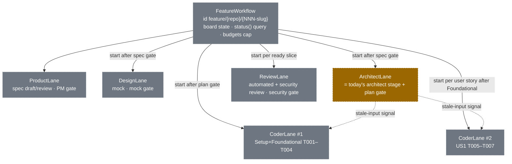
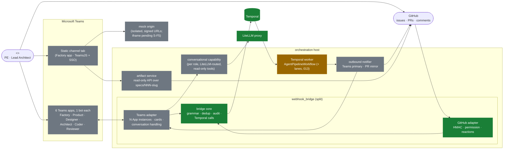

# Teams workspace — a human + agent software team, working in Microsoft Teams

**Status: designed, not built.** This doc is about the SDLC *product* tier
(`agent-factory-architecture.md` §1.1, `docs/70-multi-agent-pipeline-design.md`),
not the 8-layer foundation. Statements about this repo's code are
`file:line`-cited and were checked against the working tree on 2026-10-09
(HEAD `787cfe2`).

**Research folded in (2026-10-09).** The Teams-platform and orchestration
statements below come from the questions in
[`research/teams-workspace-research-prompt.md`](./research/teams-workspace-research-prompt.md)
and their answers in
[`research/teams-workspace-research-findings.md`](./research/teams-workspace-research-findings.md).
They are tagged in two ways:

- ***(research X.n)*** means the finding is confirmed. X is the question
  letter (A–L), and the findings doc holds its evidence, date and
  DOC/CODE/INFER label.
- ***(spike S-xx)*** means the finding is still open and needs a hands-on
  test. §17.2 lists those spikes and when each must finish.

The pinned stack is `microsoft-teams-apps==2.1.0` (Python ≥3.11),
Adaptive Cards 1.5 and TeamsJS ≥2.19 *(research A.2, E.1, F.3)*.

Every section is marked one of two ways:

- **[designed]** means the design is complete here, and a `/speckit-specify`
  run can lift it as-is.
- **[sketched → spec NNN]** means only the shape and invariants are fixed
  here, and the full design belongs to that follow-up spec.

No code exists for anything in this doc. Per `CLAUDE.md`, none gets written
without a `specs/NNN-slug/` behind it. §16 gives the spec breakdown.

---

## 1. Status, problem & Supersedes — [designed]

### 1.1 The mental model

> "The mental model is a real software team… we're just extending a current
> small team, one product engineer and one architect, with a fleet of
> agents." Work happens in a Teams chat, and the team must see real
> artifacts there: "Do we have a visualization of the architecture? Where
> can I see the mock?"

Read literally, this gives five rules. They hold everywhere below:

1. **Humans are the leads.** The product engineer (**PE**) and the architect
   (**Lead Architect**) direct the work, decide, and approve. Every Spec Kit
   checkpoint has a human in the loop.
2. **Agents are teammates.** Each agent role has its own Teams bot identity
   (§2), backed by a `registry/agents/` entry.
3. **The Spec Kit flow is the process, and Temporal enforces it.** The flow
   is specify → clarify → plan → tasks → implement → review. Concurrency is
   whatever a real team would do *within* that process (§4), not a
   free-for-all.
4. **Agents coordinate through workflow events and git artifacts. They
   don't chat with each other.** The Teams thread is the *human-visible
   projection*: a live team-board card plus handoffs, questions and
   presentations (§6).
5. **Git stays the source of truth** for specs, plans, diagrams, mocks, code
   and PRs. A Teams channel tab renders those artifacts (§8). GitHub stays
   a secondary command surface. When the same decision arrives from both
   surfaces, the first valid one wins (§12).

### 1.2 The problem today

- **One surface, one exact grammar.** The only interface is a GitHub PR
  comment that matches `orchestration/webhook_bridge/grammar.py` exactly:
  the first non-empty line, the `@pipeline-agent run` prefix with exactly
  three `key=value` tokens, or a bare gate keyword (`grammar.py:1-8`,
  `:56-63`).
- **The pipeline is opaque.**
  - `AgentPipelineWorkflow` has no `@workflow.query`, so nobody can ask
    "where is this run?".
  - Budget exhaustion is a bare `ApplicationError` with no human-visible
    notice (`orchestration/workflows/pipeline_workflow.py:113`, `:129`,
    `:146`, `:177`). Spec 005 FR-011/FR-013 name this gap but don't
    choose a surface.
- **The pipeline is strictly sequential**
  (`pipeline_workflow.py:76-180`): architect stage → plan gate → Build loop
  → Register. No two agents ever work at once.
- **No diagrams, no mocks.** The architect stage writes `plan.md`/`tasks.md`
  plus a PR comment (`harness/architect-agent/agent.py:679-777`). Nothing
  produces an architecture diagram or a UI mock, so the user's two
  questions have no answer.

### 1.3 Current code state this doc builds on

- **The plan gate is live.** `plan_approved` / `plan_rejected(feedback)` are
  `@workflow.signal` handlers (`pipeline_workflow.py:66-73`). The run
  blocks in `workflow.wait_condition` at `:140`, behind
  `workflow.patched("architect-stage-v1")` (`:83`). This is the narrow 005
  slice landed in `787cfe2`.
- **Everything else 005 specifies is absent:**
  - the `mode` parameter;
  - PM and security signals;
  - `escalation_resume` / `escalation_abandon`;
  - queries.

  The bridge still issues `pm_*` / `security_*` signals by name. They hit
  no handler, and the audit outcome is `signal_issued_no_handler`
  (`orchestration/webhook_bridge/temporal_client.py:143-149`).
- **The bridge is real.** It resolves a gate target through the
  `TargetRepo` / `PRNumber` search attributes (`temporal_client.py:86-93`).
  It is still bound by 002 FR-016: `BRIDGE_ALLOWED_REPOS` must list only
  disposable repos until 005 ships. Nothing in this doc relaxes that rule.

### 1.4 Supersedes

This doc reverses a recorded decision: "Slack/Teams surface — retired, do
not rebuild it". Each place that decision is recorded gets a pointer edit,
not a rewrite:

| Where | What it says | What changes |
|---|---|---|
| `docs/60-best-practices.md:12-22` | §3.1 design incl. "Slack/Teams + HumanLayer/gotoHuman escalation" retired | Teams **workspace** planned (this doc). HumanLayer/gotoHuman **stays retired**. |
| `docs/00-status.md:15` | Spec/Intake "Superseded" incl. Slack/Teams | Pointer to this doc, plus a "Teams workspace: designed, not built" line |
| `docs/agent-factory-architecture.md:109`, `:122`, `:129` | GitHub App collapses transport + touchpoint + approval | Teams planned as primary touchpoint. GitHub App remains transport and secondary surface. |
| `docs/70-multi-agent-pipeline-design.md:30-31` | "A developer's only interfaces … are GitHub … or the `gh` CLI" | Teams added as primary interface (planned) |
| `docs/70-multi-agent-pipeline-design.md:642-647` | "the target-repo PR thread … the sole channel" | **Coordination moves from the PR thread to workflow events + git artifacts.** Chat (Teams) and the PR thread both become *projections*. Neither is the hand-off mechanism. |
| `CLAUDE.md`, "What this repo is" | "driven entirely through a GitHub App" | "driven through Microsoft Teams (primary, planned — docs/80) and a GitHub App (secondary)" |

The docs/70 §6.1 invariant still stands: "nothing in-process ever crosses a
stage boundary". What changes is the hand-off medium. Lanes (§5) hand off
through **workflow events** (signals between parent and child workflows)
that point at **git artifacts** (commits on the feature branch). The PR
comment becomes a mirror, not the bus.

**Stays retired:**

- HumanLayer and gotoHuman (approvals are our own Adaptive Cards plus Temporal Updates and signals, §12);
- Composio and Nango transport (GitHub App plus the Teams Bot Service, §7);
- the bespoke `spec/` schema (Spec Kit is the only intake, per `CLAUDE.md`).

---

## 2. Team roster — [designed]

There is **one bot identity per role, not per instance.** Parallel coders
share the Coder bot and are told apart by an instance label. That keeps the
count at 6.

**Six roles means six Teams apps.** Manifests v1.28–v1.30 cap `bots` at one
per app, and there is no bundle concept. So each role has its own manifest,
Entra app, bot registration and install into the channel *(research K.1,
K.5)*. Only one of the six, Factory, carries the channel tab (§8.2) and the
GitHub sign-in (§13).

| Teammate | Human / agent | Backing registry agent | Teams identity | Posts | Addressed for | Spec Kit stage |
|---|---|---|---|---|---|---|
| Product engineer (PE) | human lead | — | own Teams user | decisions, direction | spec approval, scope calls, mock approval | specify, clarify, final merge |
| Lead Architect | human lead | — | own Teams user | decisions, direction | plan approval, ADR sign-off, design calls | plan, tasks, review |
| **Factory** (Coordinator) | agent (orchestrator's own voice) | none (it is the orchestration host, not a registry agent) | bot "Factory" | feature thread root, team board, gate cards, status, escalations, "resolved by" updates | `@Factory status`, `run`, `link`, `abandon` | all (process owner) |
| **Product Agent** | agent | `pm-agent` (`harness/pm-agent/agent.py`: `shape_issue()` `:175`, `review_spec()` `:240`) + planned conversational capability (010) | bot "Product Agent" | spec drafts, clarification questions, spec-review write-up | "@Product Agent shape …", "tighten FR-3", "what about offline?" | specify, clarify |
| **Designer Agent** | agent | new `designer-agent` (012) | bot "Designer Agent" | mock presentations (screenshot + tab link) | "@Designer Agent make the empty state friendlier" | specify→plan (parallel with Architect) |
| **Architect Agent** | agent | `architect-agent` (`run_architect_stage()` `agent.py:794`) | bot "Architect Agent" | plan presentation (winner, rationale, coverage, diagrams), ADRs, revision deltas | "@Architect Agent make it event-driven" | plan, tasks |
| **Coder Agent** ×N | agent | `swe-agent` (`harness/swe-agent/`) | bot "Coder Agent", posts carry an instance label, e.g. **"Coder #2 · T005–T007"** | handoffs ("T005–T007 done → PR #41 updated"), questions-to-lead | "@Coder Agent #2 why is T006 blocked?" | implement |
| **Reviewer Agent** | agent | 007's review stage (Automated-Review bundle + Security-Review, `specs/007-automated-security-review/spec.md` FR-001/FR-006) | bot "Reviewer Agent" | review and security findings presentations | "@Reviewer Agent is finding 3 a blocker?" | review |

The instance label is text inside the post, plus the board row. It is not a
separate bot identity.

- **No per-message override.** A bot can't post under a different display
  name or avatar per message. Name and icons come only from each app's
  manifest *(research K.7)*.
- **The label goes in the card.** It is the card's header line, or the
  first words of a text post.
- **Don't use `onBehalfOf`.** It attributes the message to a *human*
  ("[user] through [bot]"), and the Python SDK doesn't expose it anyway.

**Factory owns every gate card.** Agents *present* (§6.2), and Factory asks
for the decision. That keeps decisions and GitHub sign-in on one bot
(§13).

---

## 3. Journeys — [designed]

Each journey lists what it traces to: catalog rows (§11), concurrency
stages (§4) and specs (§16). The mockups are the Teams channel thread as a
human sees it. `▸` marks a card and `[ … ]` marks a button.

### J1. Shape: PE + Product Agent produce an approved spec

**Traces:**

- **§11 rows:** E1, E2, E3, E9, E10, N3, N4, N13, N14
- **§4 stage:** S1
- **Spec:** 010, with E9/E10 after 005

```
#checkout-team ─ thread "Saved carts"
PE            @Product Agent we need saved carts for logged-in users,
              see issue #212
Product Agent Read #212. Three questions before I draft:
              1. Do saved carts expire? 2. Guests too? 3. Max items?
PE            1. 30 days 2. no 3. no limit
Product Agent ▸ Spec draft v1 — specs/014-saved-carts/spec.md
                5 user stories · 9 FRs · 6 SC-NNN
                [Open in tab]  [View commit]
              My own review: FR-7 conflicts with the retention policy in
              specs/009-… — flagged as [NEEDS CLARIFICATION].
PE            make it 30 days, drop the conflict
Product Agent ▸ Spec draft v2 — delta: FR-7 rewritten   [Open in tab]
Factory       ▸ Gate · Spec approval · attempt 2
                [Approve]  [Request changes…]
PE            (clicks Approve)
Factory       ▸ Gate · Spec approval — ✅ approved by PE via Teams
              ▸ Team board (thread root, updated)
```

1. The Product Agent drafts on the feature branch. Every draft is a commit;
   the thread shows only the delta (§6.2).
2. The gate card is the Coordinator's, not the Product Agent's. The process
   owner asks for the decision; the agent only presents.
3. The PE's approval releases the PM-gate decision window. Until 005 lands,
   the 010 spec owns a narrow PM-gate slice, in the same way `787cfe2`
   landed the plan gate.

### J2. Design ‖ Architect: two lanes off one approved spec

**Traces:**

- **§11 rows:** E6, E7, E8, E11, E12, N1, N2, N5, N7, N8, N9, N12
- **§4 stage:** S2
- **Specs:** 009 (Architect + plan gate), 011 (diagrams), 012 (Designer), 013 (true parallelism)

```
Factory         ▸ Team board — 014-saved-carts
                  Product    ✅ spec v2 approved
                  Designer   ⏳ working — mock v1
                  Architect  ⏳ working — plan attempt 1 (3 candidates)
                  Coders     ·  waiting on plan approval
                  Reviewer   ·  waiting on PR
Designer Agent  ▸ Mock v1 — 4 screens (cart, saved list, empty, expiry)
                  [screenshot]   [Open mock in browser]
Factory         ▸ Gate · Mock approval · attempt 1
                  [Approve mock]  [Request changes…]
Architect Agent ▸ Plan attempt 1 — winner: candidate 2 ("event-sourced")
                  Coverage 6/6 SC · completeness: 1 gap closed
                  [C4 container diagram thumbnail]
                  [Open plan in tab]  [View PR comment]
Lead Architect  @Architect Agent drop event sourcing, a cart table is enough
Factory         ▸ Confirm: send this as plan feedback to Architect lane
                  (rejects attempt 1)?  [Send as plan_rejected]  [Cancel]
Lead Architect  (clicks Send)
Architect Agent ▸ Plan attempt 2 — delta: storage → `saved_carts` table …
Factory         ▸ Gate · Plan approval · attempt 2
                  [Approve]  [Request changes…]
Lead Architect  (approves on GitHub with `plan_approved`)
Factory         ▸ Gate · Plan approval — ✅ approved by @lead-arch via GitHub
                  (Teams card updated in place; buttons removed)
```

1. **The Designer and the Architect read only the approved spec**, so they
   are independent (§4, S2). The mock gate and the plan gate are separate
   windows, and either may close first.
2. **Addressing an agent mid-gate is feedback, not chat.** "@Architect
   Agent …" while the plan window is open becomes a confirm card. The
   confirmed text becomes the plan window's rejection with feedback. Teams
   sends it as a validated Update (§12.1), which carries the same payload as
   the `plan_rejected(feedback)` signal `pipeline_workflow.py:71-73` already
   handles. Agent addressing never starts or changes a lane without a lead's
   click (§7.3).
3. **"Resolved by X via GitHub"** comes from first-valid-wins (§12). The
   Teams card is updated in place, so nobody clicks a dead button.

### J3. Build: Coders fan out per user story

**Traces:**

- **§11 rows:** E5, N1, N2, N5, N6, N15
- **§4 stages:** S3, S5, S6
- **Spec:** 013

```
Factory      ▸ Team board — 014-saved-carts
               Coder #1   ⏳ T001–T004 Setup+Foundational  lane/014/c1
               Coder #2   ·  US1 T005–T007 (after phase 2) lane/014/c2
               Coder #3   ·  US2 T008–T009 (after phase 2) lane/014/c3
               Reviewer   ·  waiting on first slice
Coder Agent  Coder #1 · T001–T004 ✅ → merged into 014-saved-carts
             (handoff: Coders #2, #3 rebased onto it)
Coder Agent  Coder #3 · question for @PE: T009 says "badge" — count of
             items or count of carts?
PE           items
Factory      ▸ Team board (Coder #3 ⏳ unblocked)
```

1. **Fan-out follows `tasks.md` the way upstream Spec Kit means it.**
   - Setup and Foundational run first, as a barrier.
   - Then each user-story phase gets its own Coder lane. Upstream's unit
     of parallel team work is the user story ("Developer A: User Story 1").
   - `[P]` only marks tasks that one agent may run together *(research
     L.3)*.

   §5.1 invariant 4 gives the exact rule.
2. **Progress goes on the board, never in the thread** (§6.4). The thread
   gets only handoffs and questions.

### J4. Review: the Reviewer presents

**Traces:**

- **§11 rows:** E13, N11
- **§4 stage:** S4
- **Spec:** after 007

```
Reviewer Agent ▸ Review of PR #41 slice T005–T007
                 Blocking (2): silent catch in cart_service.py:88; …
                 Advisory (5) — collapsed
                 Security: no findings above threshold
                 [Open review in tab]  [View PR review]
Factory        ▸ Gate · Security clearance · attempt 1
                 [Clear]  [Reject…]
```

1. Blocking findings route back to the owning Coder lane as feedback
   (007 FR-005).
2. The security gate stays a human decision in every mode (007 FR-008/FR-011).

### J5. Stuck: escalation with resume, abandon or takeover

**Traces:**

- **§11 rows:** E14, N10
- **§4 stages:** S3, S4 (budget exhaustion)
- **Specs:** after 005, and 013 for per-lane budgets

```
Factory ▸ ⚠ Escalation — Coder #2 lane exhausted its budget (3/3)
          Stage: build loop · last failure: Eval-Gate — no SC-NNN found
          Branch lane/014/c2 · PR #41
          Take over: git fetch origin lane/014/c2 && git switch lane/014/c2
          [Resume (one more attempt)]  [Abandon…]  [I'll take over]
```

1. **Resume and Abandon** are 005's `escalation_resume` /
   `escalation_abandon(reason)`, with the FR-012 resume semantics: re-enter
   the stage at the head of its loop.
2. **"I'll take over"** pauses that lane (a lane-level signal, §5). It
   records the human as the lane owner and adds them to the board row. The
   human pushes to the lane branch with any tool; resuming the lane rebuilds
   from what they pushed. This is tool-agnostic by design.

### J6. Done

**Traces:**

- **§11 rows:** E15, E16, N1
- **§4 stage:** S7
- **Specs:** 009 (board terminal state), merge event after 009

```
Factory ▸ Team board — 014-saved-carts ✅ merged
          PR #41 merged by @pe · 3 coder lanes · 2 plan attempts · 1 mock rev
          [Open feature in tab]
```

The run's terminus is the **merged target-repo PR**. Today's
`register_activity` (`orchestration/activities.py:293`) still writes a
registry entry, which is the foundation tier's terminus grafted onto a
product run (see `CLAUDE.md`'s Orchestration row). The board shows Register
only as long as that mismatch exists.

---

## 4. Concurrency per process stage — [designed]

This answers "multiple agents at once". Concurrency happens only where a
real team would work in parallel, and every parallel lane reads an
**approved, versioned** input.

| ID | Trigger (process event) | Runs in parallel | Reads (pinned) | Waits | Decision point |
|---|---|---|---|---|---|
| S1 | Shape requested (J1) | Product Agent alone | issue, thread history | — | spec approval (PE) |
| S2 | **Spec approved** | **Designer ‖ Architect** | spec.md @ approved SHA only | Coders, Reviewer | mock approval (PE), plan approval (Lead Architect), independent windows |
| S3 | **Plan approved** | **Coders: one lane on Setup + Foundational (barrier), then one lane per user-story phase** (§5.1 inv. 4); Designer may keep iterating the mock if not yet approved | plan.md + tasks.md @ approved SHA | Reviewer waits on PR/slice readiness | none per group; budget exhaustion → J5 |
| S4 | **A PR slice is ready** | **Reviewer presents while Coders continue** on other groups | slice diff | — | security clearance (after 007) |
| S5 | **Lead Architect revises mid-build** (human-triggered, "@Architect Agent …" + confirm) | Architect re-plans **only affected tasks**; unaffected Coder lanes continue | plan @ new attempt | affected lanes get **stale-input**, pause at the next task boundary | plan approval of the revision |
| S6 | **PE changes the approved spec** | nothing new starts | — | all downstream lanes marked **stale**; Coordinator asks leads how to proceed (N15) | leads choose: re-plan affected / continue / abandon |
| S7 | All slices reviewed + cleared, PR merged | — | — | — | human merge (outside Temporal) |

Rules that make the table safe:

1. **No lane ever reads another lane's in-progress output.** It reads only
   artifacts at an approved SHA, which extends 004's no-cross-candidate
   visibility up to lane level.
2. **"Affected" is computed, not guessed.** A plan revision diffs the old
   and new `tasks.md`. Changed or added task IDs and their file paths decide
   which lanes go stale.
3. **Stale means pause at a task boundary, never kill.** Work already
   committed on a lane branch is kept, and the lane rebases or re-plans when
   the leads decide.

---

## 5. Lane model — [sketched → spec 013 + ADR amending 005]

Today one `AgentPipelineWorkflow` per `repo/agent/version`
(`temporal_client.py:40-46`) runs every stage in sequence. The lane model
adds a feature-level parent workflow, `FeatureWorkflow`. Each role's work
becomes a **child workflow (lane)**. 005's gate signals and decision windows
then apply **per lane**.



`ArchitectLane` is **partial**: its body exists today as
`pipeline_workflow.py:83-150`. The rest is a stub.

### 5.1 Invariants, fixed here

1. **Branch ownership per lane.** Each lane owns exactly one sub-branch,
   `lane/<NNN>/<role><n>`.
   - **No worktrees.** Each lane already runs in its own E2B sandbox, so
     worktrees add nothing *(research L.4)*.
   - **Only the `FeatureWorkflow` merges** lane branches into the feature
     branch. It does so through a code-side activity, never a model,
     matching 004's "persist/push is code-side" rule.
   - **The merge activity pre-checks** with `git merge-tree --write-tree`,
     which needs no checkout and exits 1 on conflict.
   - **A conflict is a lane failure** that charges that lane's budget, never
     a silent resolution.
   - **This matches existing tools.** Copilot coding agent, Claude Code and
     Codex all leave merges to a human or coordinator *(research L.4)*.
2. **Artifact versioning per attempt.** Every presented artifact carries
   the architect's existing marker shape, `attempt=N spec=SHA`
   (`architect-agent/agent.py:695`). The same shape extends to mocks
   (`mock attempt=N spec=SHA`) and diagrams. The board shows that version.
3. **Stale-input signal.** When an upstream artifact gets a new approved
   version (plan revision, spec change), the parent signals each consuming
   lane `stale_input(artifact, new_sha, affected_task_ids)`. The lane
   pauses at its next task boundary.
4. **Fan-out rule (user story, not `[P]` run).** Upstream Spec Kit
   (v1.1.2) defines `[P]` per task only: "different files, no dependencies
   on incomplete tasks". It has no grouping rule and no machine-readable
   dependency notation. Its unit of parallel team work is the **user story**
   *(research L.3)*. So:
   - **Barriers are Setup, then Foundational, then Polish.** One serial
     Coder lane runs Setup + Foundational. Polish runs after every story
     lane has merged.
   - **One Coder lane per user-story phase.** These lanes start together
     once Foundational merges. A story phase may be split further into
     `[P]` runs whose task file paths are disjoint.
   - **Dependencies are ours to compute.** We do a best-effort parse of
     free-text "(depends on T012, T013)" and fall back to file-path
     overlap. Overlapping stories run in one lane.
   - **`/implement`'s failure rule maps onto lane outcomes.** A failed
     non-`[P]` task fails the lane and charges its budget. Failed `[P]`
     tasks are reported, and the rest of the lane continues.
   - **Spec Kit version.** The repo's CLI is 0.13.0 and upstream is
     1.1.2. The local `tasks-template.md` matches upstream except for one
     placeholder line. Whether to bump is decided in §16.
5. **Budgets per lane, plus a feature-level cap.** Each lane keeps 005's
   per-stage budget (`MAX_PLAN_ATTEMPTS=3` `pipeline_workflow.py:43`,
   `MAX_BUILD_ATTEMPTS=3` `:37`). The parent adds a feature-level cap on
   total charged attempts, and exhausting it escalates the whole feature.
6. **Lanes outlive the parent's continue-as-new.** Child workflows don't
   carry over when a parent continues-as-new. Under the default
   `ParentClosePolicy.TERMINATE`, that **kills every running lane**
   *(research L.1)*. So:
   - **Start lanes with `ABANDON`** and deterministic ids
     (`feature/{repo}/{NNN}/{role}{n}`).
   - **Re-address lanes by id** through
     `workflow.get_external_workflow_handle`.
   - **Lanes report upward by signal** to `workflow.info().parent.workflow_id`,
     without a `run_id`, so the signal survives the parent's
     continue-as-new.
   - **The parent continues-as-new only after
     `workflow.all_handlers_finished`.** It is suggested at 4,096 events,
     4 MiB, or 90% of the 2,000-update cap.
   - **Dedup update ids across runs in workflow state.** Temporal dedups
     update ids per run only.

### 5.2 Deferred to 013

The full design is 013's. It covers:

- lane start mechanics: signal-with-start is the default *(research L.1)*; 013 decides where update-with-start is worth its non-atomicity;
- `continue-as-new` for a feature that lives for weeks;
- how 005's single-run `mode` maps onto a feature;
- migrating today's `AgentPipelineWorkflow` (a new workflow type, per 005
  FR-015's "new workflow name" option);
- an **ADR amending 005**. 005 specifies gates on one run; 013 moves them
  to lanes.

---

## 6. Chat protocol — [designed]

### 6.1 One feature, one thread

- Each feature (`specs/NNN-slug`) gets **one channel thread**. Its root
  post is the **team board card**, posted and owned by Factory.
- The board has one row per teammate. Each row shows the teammate's state
  (`working` · `waiting` · `presenting` · `blocked` · `done`), the current
  artifact version (`plan attempt 2 @ a1b2c3d`) and a link (tab
  sub-entity or PR).
- Factory **updates the board in place** on every workflow event, so the
  thread never fills with status posts. The update goes through
  `app.api.conversations.update_activity(conv_id, activity_id, …)`, which
  works from a Temporal activity with no HTTP server *(research E.3)*.
  - **Factory is the board's only editor.**
  - **The board is sent as an attachment-only activity.** If text and a
    card go out together, Teams splits them and returns no id to update.
  - **Updates are debounced and coalesced**, because they count against
    the shared per-thread rate limit (§7.5).

### 6.2 What agents may post

These are the only kinds of message agents post:

| Kind | Example | Rule |
|---|---|---|
| **Handoff** | "plan v3 ready → Coders pick up T001–T004" | one per artifact version; names the consumer |
| **Question-to-lead** | "@PE: badge = items or carts?" | must @mention a lead; lane shows `blocked` on board until answered |
| **Presentation** | Architect's plan card, Designer's mock card, Reviewer's findings | one per attempt; always links the git artifact; never the full artifact inline (§14.7) |

Agents never post progress, acknowledgements ("on it!"), or messages
addressed to another agent.

Every agent-authored post carries:

- the **"AI generated" label**;
- **citations** to its git artifact paths (at most 20);
- **👍/👎 feedback** buttons.

All three work in channels. **Streaming doesn't**: it is one-on-one chat
only, and typing indicators in channels are unconfirmed *(research C.4)*.
Agents therefore post a finished message, and in-progress state lives on the
board.

### 6.3 Addressing an agent

"@Architect Agent make it event-driven" is routed as **feedback to that
role's lane**, as follows:

- **The lane has an open decision window.** Factory posts a confirm card
  that turns the text into that window's rejection with feedback (J2). The
  lane's own gate keeps its semantics.
- **The lane is running, with no window open.** The text is queued as
  pending feedback for the lane's next attempt. A lead must confirm before
  it triggers a revision (S5).
- **The message is a question** ("why is T006 blocked?"). The agent answers
  in-thread from read-only context (§7.3). No lane is touched.

Whether "this is a question" or "this is a change request" is decided by
the agent's conversational capability. A misclassification can only cost a
confirm card, never a lane change.

### 6.4 Noise budget

- The thread gets no progress chatter. Progress lives on the board.
- At most **one presentation per artifact attempt**, and only
  **delta-only** follow-ups ("v2 — delta: FR-7 rewritten"), the same
  pattern as the architect comment's `**Delta:**` line
  (`architect-agent/agent.py:698-699`).
- At most one open question per lane at a time.

### 6.5 Inter-agent isolation

Agents don't read each other's chat messages.

- **What the platform does is unconfirmed.** No primary source says whether
  bots receive each other's channel messages (spike S-K2).
- **We enforce the rule ourselves.** The Teams adapter drops any inbound
  activity whose `from.id` is one of our six bot ids. Bot ids start with
  `28:` *(research K.2)*.
- **Routing.** Without RSC, only the @mentioned bot gets an activity *(research
  K.6, INFER)*. Factory alone holds RSC `ChannelMessage.Read.Group` (§7.3),
  so it receives everything and acts only when `is_recipient_mentioned()`
  is true, or to append to the thread log.

---

## 7. Teams app & system architecture — [designed]

### 7.1 Diagram



The pieces:

- **Six Teams apps** (one per §2 role). Each has its own manifest, Entra
  app, bot registration and channel install *(research K.1)*.
  - **One static tab**, in Factory's app (§8.2).
  - **A standard channel.** Shared channels don't support bots, and agents
    can't post in private channels *(research J.1, C.1)*.
- **The bridge splits into a core and two adapters** (§7.2).
- **The Teams adapter is one process with six `App` instances**, mounted in
  the existing aiohttp `webhook_bridge` *(research B.6, K.3)*.
  - **Mounting** uses a ~25-line `HttpServerAdapter`, and each `App` gets
    its own `messaging_endpoint` route.
  - **Startup order.** Call `await app.initialize()` for every `App`
    *before* aiohttp's `AppRunner.setup()`, which freezes the router.
  - **Dependencies.** FastAPI and uvicorn remain hard installs, even though
    we don't use them.
  - **Route shadowing.** `@app.func` (`/api/functions/<name>`) and
    `/tabs/<name>/` routes ignore `messaging_endpoint`, so two apps on one
    adapter can silently shadow each other's routes. Only Factory registers
    any of them.
  - **No shared global state** was found in the SDK. The hazard is
    credential fallback (§15).

### 7.2 Bridge core / adapter split

`orchestration/webhook_bridge/` is today one GitHub-shaped process. The
split keeps every rule it already enforces and moves only the transport
edges:

| Part | Files (today) | Becomes |
|---|---|---|
| **Core** | `grammar.py` (command shapes `RunCommand`/`GateCommand` `:34-47`); `dedup.py` (`DeliveryCache.reserve` `:19-29`); `audit.py` (outcome set `:12-23`); the Temporal half of `temporal_client.py`: `workflow_id` `:40`, `start_run` `:55-74`, `resolve_gate_target` `:86-93`, the signal call inside `signal_gate` `:96-150` | surface-neutral: takes a `Command` + `Actor` + `Origin`, returns an outcome. Dedup keys become `"{surface}:{delivery_or_activity_id}"` |
| **GitHub adapter** | `auth.py` (HMAC `:15-21`, permission `:24-35`); `github_app.py` (installation token, `get_permission` `:72`, `get_pull_request` `:84`, `post_reaction` `:101`); `server.py` dispatch `handle_webhook` `:75-148`, `_dispatch_run` `:150-207`, `_dispatch_gate` `:209-221`; reactions pulled out of `temporal_client.py` (`_react` `:152-156`, and the `"confused"`/`"eyes"` calls at `:124`, `:140`, `:149`) | parses comments into core commands; renders outcomes as reactions (unchanged behaviour) |
| **Teams adapter** (new) | — | Teams SDK `App` per identity *(research A.4, B.6, K.3)*; tenant allow-list (§13); turns @mentions / `Action.Execute` invokes into core commands; renders outcomes as card states (§14.8) |

**The reactions move out of `temporal_client.py`.** Today `signal_gate`
mixes the Temporal call with GitHub reactions (`temporal_client.py:96-150`).
After the split, `signal_gate` returns the outcome and the adapter renders
it.

**The core gains an Update path** for Teams decisions (§12.1):

- It calls `handle.start_update(…, wait_for_stage=WorkflowUpdateStage.ACCEPTED, rpc_timeout=…)`.
- It maps `WorkflowUpdateRPCTimeoutOrCancelledError` to a new outcome,
  `worker_unavailable`.
- That outcome is needed because Updates block until a worker accepts them,
  while signals need no worker *(research L.1)*.

**Dedup keys for Teams** use `activity.id`. It is stable across edit and
delete notifications, but no doc promises at-least-once delivery, so using
it as a dedup key is our inference *(research J.3)*.

### 7.3 Conversation handling

1. **Where it runs.** Each role's conversational capability runs on the
   **orchestration host**, LiteLLM-routed. That is the same placement and
   routing as `pm-agent`'s `review_spec()`. It does not run in E2B, which is
   the same carve-out docs/70 §6.1 grants code-free stages.
2. **Context.**
   - **The thread history comes from our own thread log.** The activity
     stream carries no history. Factory holds RSC `ChannelMessage.Read.Group`,
     which the team owner consents to at install. Factory therefore receives
     every channel message and appends it to a Postgres table keyed by
     thread *(research C.1, C.2)*. Graph
     `GET …/messages/{id}/replies` stays a backfill path only; whether it
     counts as a protected API is unconfirmed (spike S-C2).
   - **Mention stripping.** The Python SDK has no mention route, and its
     default `strip_mentions_text()` removes *every* mention. Pass
     `StripMentionsTextOptions(account_id=recipient.id)` so other @mentions
     survive as context *(research C.5)*.
   - The lane's branch, read with `Read` / `Grep` / `Glob` only, under
     `setting_sources=[]`.
   - Credentials scrubbed around the model call, as in `pm-agent` and
     `architect-agent`.
3. **What it may do without a human.** Answer, and propose an action.
   **Any action that starts a lane, or changes a lane's input, needs a
   confirm card clicked by a lead** (§13). That covers feedback-as-rejection,
   re-plan, takeover and abandon.

### 7.4 Artifact service

- A **read-only** HTTP API on the orchestration host. It reads
  `specs/NNN-slug/**` from the feature branch at a given SHA, using the
  GitHub App installation token (`github_app.py:48-70`). It never writes.
- **Tab auth.** The tab sends the **`getAuthToken()` access token itself**.
  On-behalf-of exchange is only needed for calls to Graph *(research
  F.2)*. The API validates:
  - `aud` = our Entra client id (GUID);
  - `iss` and `tid` = our tenant;
  - `scp` contains `access_as_user`;
  - the user, taken from the `oid` claim, never from TeamsJS context.

  The Python SDK's `TokenValidator.for_entra` can do this validation
  *(research A.3)*. The service then checks that the user may see the repo
  linked to that channel (§13).
- **Mocks** are served from a **separate, isolated origin** (§15), which can
  never take part in SSO, because an Entra app supports one domain
  *(research F.2)*.
  - **Signed URLs.** Mocks are served on short-lived signed URLs minted by
    the artifact service.
  - **Ship "Open mock in browser" first.** Embedding as
    `<iframe sandbox="allow-scripts">` (no `allow-same-origin`) inside the
    tab is undocumented by Microsoft, so it waits on spike S-F5 across web,
    desktop, iOS and Android.
  - **Strict CSP on the mock origin:** `default-src 'none'`,
    `connect-src 'none'`, `form-action 'none'`, `img-src data:`, only the
    inline script and style the bundle needs, and
    `frame-ancestors <tab origin>` *(research F.5, I.3)*.
  - **The mock origin is listed in `validDomains`** as a precaution.

### 7.5 Outbound notifier

There is **one fan-out step**: a workflow event goes to Teams (primary) and
to a PR comment (mirror).

- **v1 (009).** Factory adds Teams posts *alongside* today's direct
  `gh pr comment` / `gh pr create` calls. Those are `ensure_target_pr_activity`
  (`activities.py:153`), `register_activity` (`activities.py:293`) and
  `post_stage_comment` (`architect-agent/agent.py:777`), and they stay
  unchanged. The notifier is a new activity, `notify_activity(event)`.
  - **No inbound request needed.** It builds each bot's `App` (all
    credentials passed explicitly, §15), calls `await app.initialize()`
    with no HTTP server, then uses `app.send` / `app.reply` /
    `update_activity`, all from the stored scalars in §10.4 *(research
    D.1, D.3)*.
  - **One shared outbound rate limiter per channel.** All bots posting in
    one channel share 14 sends/s and 16 per 2 s, and card updates count
    too. Per bot and conversation the limits are 7/s, 8 per 2 s, 60 per
    30 s and 1,800 per hour. Each app gets 50 requests/s per tenant
    *(research J.1, K.4)*.
  - **Retries.** 429, 412, 502 and 504 are retried with jittered
    exponential backoff.
  - **Size check.** Every outbound activity is checked against
    `len(json.dumps(activity).encode("utf-16-le")) < 80_000`
    *(research E.5)*.
- **Target.** The notifier becomes the "workflow-side notification step"
  that 005 FR-011/FR-013 require. That step's escalation and abandonment
  notices are rendered by both surfaces.

---

## 8. Artifact model — [designed]

### 8.1 Conventions under `specs/NNN-slug/`

| Path | Producer | Reviewer / gate | Rendered as |
|---|---|---|---|
| `spec.md` | PE + Product Agent (J1); today human via `/speckit-specify` | PE, PM gate (005) | tab: Spec |
| `plan.md`, `tasks.md` | Architect Agent (`persist_synthesized`, `architect-agent/agent.py:627`) | Lead Architect, plan gate (`pipeline_workflow.py:66-73`) | tab: Plan; board row link |
| `adr/NNNN-*.md` | Architect Agent (011), Lead Architect | Lead Architect at plan gate | tab: Architecture |
| `diagrams/*` (source per §9.1) + `diagrams/*.mmd` + `diagrams/*.png` | Architect Agent (011) — source is validated, `.mmd` is exported for the tab, `.png` rendered server-side for cards | validated by the §9.1 gate (not by mermaid parse); Lead Architect at plan gate | tab: Architecture (client-side mermaid); card: PNG thumbnail (≤1024×1024) |
| `mocks/index.html` + `mocks/*.png` | Designer Agent (012) — self-contained HTML (compiled Tailwind, inlined), Playwright screenshot per screen | PE at mock gate | tab: Mock view = screenshots + "Open mock in browser" (signed URL); sandboxed iframe after spike S-F5; card: screenshot |
| `artifacts.json` (optional) | whichever producer last wrote | — | tab index: `{kind, path, attempt, spec_sha, produced_by}` per artifact; absent → tab globs by convention |

The table's last column follows from git being the source of truth. The tab
and the cards only ever render a path at a SHA, so nothing is stored only in
Teams.

### 8.2 Tab wireframes

The tab is **one static tab** in Factory's app:

- **Manifest.** `staticTabs` with `scopes: ["team"]` and
  `context: ["channelTab"]`, on manifest ≥1.16.
- **Why one tab.** Configurable tabs are kept only for backward
  compatibility. Only static tabs can be pinned now, and only one per app
  *(research F.1)*. So Spec, Architecture, Mock, Plan, Board and Review are
  routes inside that one tab, not separate tabs.
- **No config page.** Linking a channel to a repo can't happen in a tab
  config page; it comes from `@Factory link` or static config (§10.3).

```
┌ Factory tab ─────────────────────────────────────────────┐
│ Features                                    [filter ▾]   │
│ ● 014-saved-carts      Build · 3 lanes · plan a2   →     │
│ ● 013-order-export     Review · security gate open →     │
│ ✓ 012-price-rounding   merged 2026-10-02           →     │
└──────────────────────────────────────────────────────────┘

┌ 014-saved-carts ──────────── branch 014-saved-carts @ a1b2c3d ┐
│ [Spec] [Architecture] [Mock] [Plan] [Board] [Review]          │
│ ─────────────────────────────────────────────────────────────  │
│ Architecture · plan attempt 2 · spec a1b2c3d                  │
│  ┌ C4 container (mermaid, rendered client-side) ┐             │
│  │  …                                           │             │
│  └──────────────────────────────────────────────┘             │
│  ADR-0001 Use a table, not event sourcing   (accepted)        │
│  Sequence: save cart · restore cart                           │
│  [Open in GitHub]                                             │
└────────────────────────────────────────────────────────────────┘
```

Each view is a sub-entity, `subEntityId = "{NNN-slug}/{view}[/{attempt}]"`:

- **Reading it.** The tab gets it from `app.getContext()` as
  `page.subPageId`.
- **Deep links.** Card buttons use `Action.OpenUrl` to
  `https://teams.microsoft.com/l/entity/<appId>/<entityId>?context=<URI-encoded {"subEntityId":…,"channelId":…}>`,
  at most 2,048 characters *(research E.6, F.7)*. A link in plain card
  text opens a new browser tab on Linux.
- **Unverified for static tabs.** The deep-link doc still says
  `channelId` works only for configurable tabs. Whether the link reaches a
  static tab pinned in a channel, on desktop, web and mobile, is spike
  S-F7. Until it passes, buttons also carry a plain GitHub link.

**Tab hosting requirements** *(research F.3, F.4)*:

- TeamsJS ≥2.19, with `app.initialize()` called.
- A public HTTPS certificate; self-signed isn't supported.
- No login redirects inside the frame.
- `frame-ancestors` set to the Teams host origins.
- Mermaid ≥11.16.1 (CVE-2026-50159) with `securityLevel: 'strict'`, the
  same version on the server and in the tab. Mermaid injects `<style>`
  without a nonce, so the tab's CSP needs `style-src 'unsafe-inline'`. Each
  diagram gets its own container.
- Markdown renders with raw HTML disabled and the output sanitised
  *(research I.3)*.

---

## 9. New producers — [sketched → specs 011, 012]

### 9.1 Architecture diagrams → spec 011

This extends `architect-agent`'s 004 output contract
(`specs/004-architect-fanout-judge/contracts/architect-agent-interface.md`).
The synthesized winner also produces:

- a C4 **container** diagram;
- a C4 **component** diagram for the changed container(s);
- 1–3 **key sequences**.

**"Validate by parsing mermaid in Python" doesn't work** *(research I.1)*:

- There is no Python mermaid parser.
- Mermaid C4 is "experimental". In a local test (mermaid 12.1.0, mmdc
  12.0.0), `mermaid.parse` accepted a C4 diagram with a missing `)`, and
  `mmdc` rendered a wrong PNG with exit 0. A relation to an undefined
  element also parsed and failed only at render.
- Structurizr `validate` rejected all three faults with line numbers.

So 004's rule ("validated in code, not trusted from the model") becomes:

- **Source: Structurizr DSL** (`diagrams/workspace.dsl`), generated by the
  model.
- **Gate: `structurizr validate`.** A non-zero exit makes the candidate
  invalid, the same way a malformed plan does.
- **Exports, code-side after `persist_synthesized`, never by the model:**
  - `export -format mermaid` to `diagrams/*.mmd`, for the tab;
  - `mmdc` on those exports to `diagrams/*.png`, for cards.

  Rendering PNGs through `mmdc` avoids Structurizr's 4.03 GB `-playwright`
  image. It still needs Chromium (§15).
- **Fallback, if 011's eval shows the model can't produce DSL reliably:**
  mermaid `flowchart` with C4-styled classes. It is gated by
  `mermaid.parse` in Node (with a jsdom shim), a render that must exit 0,
  and our own check that every edge endpoint is declared. Mermaid
  `C4Context` syntax is not used.
- **Still open for 011:**
  - the LLM pass rate per format (no primary source measures it);
  - whether diagrams count toward the SC-NNN coverage map.

### 9.2 Designer / mock agent → spec 012

A new `designer-agent` with a `registry/agents/designer-agent/` entry
(manifest + `SKILL.md`, per the registry portability rule in `CLAUDE.md`).

- **Input.** User stories from the approved `spec.md` only (S2).
- **Output.** A **clickable static prototype**: self-contained HTML with
  **compiled Tailwind** (v4 standalone binary, no Node), CSS inlined, no
  network, plus one screenshot per screen *(research I.2)*. The Tailwind
  Play CDN is forbidden: it is "for development purposes only" and breaks
  the no-network rule.
- **Screenshots** use Playwright for Python:
  `page.screenshot(full_page=True, animations="disabled")` in a context
  with `offline=True` and `service_workers="block"`.
- **Runs in the E2B sandbox.** It executes a headless browser, so the §6.1
  code-free carve-out doesn't apply. Whether the E2B template has Chromium
  is unchecked (spike S-I2, before 012).
- **Reviewed at the mock gate.** The gate is `mock_approved` /
  `mock_rejected(feedback)`, owned by 012, with 005-style decision windows.
  Teams sends it as an Update (§12.1).
- **Not primary outputs:**
  - **Figma.** Writing to the canvas needs a Full-seat human session
    through Figma's MCP server, and no headless path is documented.
  - **Storybook.** Used only when the target repo already has a component
    library.
  - **Design-system components** were not researched.

---

## 10. Correlation — [designed]

```
Teams thread (TeamsThreadId) ──1:1── feature (specs/NNN-slug, FeatureBranch, target PR)
                                          └─1:N── lanes / runs (workflow ids)
Teams channel ──N:1── repo   (config + `@Factory link owner/repo`)
```

1. **New custom search attributes**, sitting next to `TargetRepo` (Keyword)
   and `PRNumber` (Int) (`temporal_client.py:66-69`, registered per
   `specs/002-webhook-trigger-bridge/quickstart.md:6-8`):
   - `TeamsThreadId` (Keyword): the channel thread's conversation id, in
     the format `19:…@thread.tacv2;messageid=<root id>` *(research C.3)*.
     **Caveat:** a Microsoft doc says "the conversation ID is unique for
     each agent within a specific channel", while the threaded format is
     built from global ids. Spike S-D4 must show that all six bots see the
     same id for one thread. If they don't, `TeamsThreadId` holds
     Factory's id, and the other bots resolve through the per-bot rows in
     item 4;
   - `FeatureBranch` (Keyword): e.g. `014-saved-carts`.
2. **Resolving a gate from Teams** reuses the `resolve_gate_target` pattern
   (`temporal_client.py:86-93`): exactly one Running match or a named
   failure. The query becomes
   `TeamsThreadId = '…' AND ExecutionStatus = 'Running'` (plus a lane
   filter after 013). Zero or multiple matches produce the same
   `signal_failed` outcomes and reasons as today.
3. **Repo ↔ channel mapping.**
   - **Static:** config `TEAMS_CHANNEL_MAP` (§15).
   - **Dynamic:** `@Factory link owner/repo`. It is admin-gated (§13) and
     checked against `BRIDGE_ALLOWED_REPOS`, so a channel can never link a
     repo the bridge would refuse.
4. **What is persisted for proactive sends: scalars, not a serialized
   conversation reference** *(research D.1, D.4)*. The table lives in
   Postgres on the orchestration host.
   - **Key:** `(teams_thread_id, bot_app_id)`, until spike S-D4 shows the
     id is shared across bots.
   - **Columns:**
     - threaded conversation id;
     - `service_url`, refreshed on every inbound activity because no
       lifetime is documented;
     - `tenant_id`, `team_id`, `channel_id`;
     - root activity id;
     - the board card's activity id.
   - **Prerequisite:** the app is installed in the team before its first
     post *(research D.2)*.
   - **New threads.** The thread root comes from `app.send(<bare channel
     id>, card)`, and the returned `SentActivity.id` becomes the root id.
     This rests partly on an archived doc, so spike S-D4 confirms it too.
   - **The workflow carries only `TeamsThreadId`**, never credentials.

---

## 11. Interaction catalog — [designed]

### 11.1 Existing touchpoints

There are **16 existing touchpoints**, enumerated from code and workflows,
not from docs/70 §1.2. §1.2 lists checkpoint *kinds* (3 signal gates,
escalation, 2 out-of-Temporal actions). The 16 below add every concrete
inbound command and outbound post.

| ID | Touchpoint (today) | Posting bot (Teams) | Surface | GitHub mirror | Backing call | Phase |
|---|---|---|---|---|---|---|
| E1 | Human writes spec via `/speckit-specify → plan → tasks` | Product Agent (drafts, J1) | chat + tab | commits on feature branch | today manual; 010 product lane | 010 |
| E2 | `@pm-agent shape` issue comment (`pm-agent-shape-trigger.yml` → `pm-agent-shape.yml`) | Product Agent | chat | issue comment (unchanged trigger stays) | `shape_issue()` `harness/pm-agent/agent.py:175` | 010 |
| E3 | Shape result: original preserved as comment + `gh issue edit` (`pm-agent/agent.py:212`, `:221`) | Product Agent | card (delta) | is the source | same | 010 |
| E4 | `@swe-agent build` PR comment (`swe-agent-trigger.yml` → `swe-agent-build.yml`, Build-only) | none — GitHub-only by design; superseded by Coder lanes | — | is the source | GHA + `@e2b/cli` | 013 decides deprecation |
| E5 | Build PR opened/updated (`run_swe_agent_activity` `activities.py:72`) | Coder Agent (handoff); Factory (board row) | chat + board | PR itself | same | 009 board · 013 Coder bot |
| E6 | `@pipeline-agent run mode= agent= version=` → `start_run` (`temporal_client.py:55`) | Factory | chat + confirm card | PR comment "started from Teams by X" | `start_run` via bridge core | 009 |
| E7 | Bridge reactions 🚀/👀/😕 (`server.py:223`, `temporal_client.py:152`) | Factory | card state (§14.8) | reactions unchanged | adapter render of core outcome | 009 |
| E8 | Target PR ensured (`ensure_target_pr_activity` `activities.py:153`) | Factory | board link | PR itself | same | 009 |
| E9 | PM spec-review write-up (`review_spec()` `pm-agent/agent.py:321`; no producer wired) | Product Agent | presentation card | PR comment (kept) | `review_spec()` | after 005 |
| E10 | `pm_approved` / `pm_rejected: …` (parsed, `grammar.py:21-31`; **no handler**) | Factory | gate card | PR comment grammar still accepted | `signal_gate` | after 005 (or 010 narrow slice) |
| E11 | Architect stage comment (`post_stage_comment` `architect-agent/agent.py:679-777`) | Architect Agent | presentation card + tab Plan | PR comment (kept, idempotent marker `:695`) | `architect_stage_activity` `activities.py:183` | 009 |
| E12 | `plan_approved` / `plan_rejected: …` (**handler live**, `pipeline_workflow.py:66-73`, wait `:140`) | Factory | gate card | PR comment grammar still accepted; decision mirrored | Teams: validated Update `decide_plan` (§12.1); GitHub: `signal_gate` | 008 (Update + validator, set-if-unset) · 009 (Teams card) |
| E13 | `security_cleared` / `security_rejected: …` (parsed; no handler, no review stage) | Factory (gate) · Reviewer Agent (presents) | gate card | PR comment grammar | `signal_gate` | after 007 |
| E14 | Budget exhaustion — today a silent `ApplicationError` (`pipeline_workflow.py:113`, `:129`, `:146`, `:177`); 005 designs `escalation_resume` / `escalation_abandon(reason)` | Factory | escalation card (J5) | PR comment (notifier mirror) | 005 signals + notifier | after 005 |
| E15 | Register: factory-repo PR (`register_activity` `activities.py:293`) | Factory | board terminal row | PR itself | same | 009 (board only) |
| E16 | Human merges target PR; registry PR's `pr_merged` has no sender (`registry_promotion_waiter.py:24-25`) | Factory | board "merged" + J6 post | is the source | bridge subscribes to `pull_request.closed` | after 009 |

### 11.2 New touchpoints

| ID | Touchpoint (new) | Posting bot | Surface | GitHub mirror | Backing call | Phase |
|---|---|---|---|---|---|---|
| N1 | Feature thread root + **team board** card | Factory | card (updated in place) | — | notifier + card update (research E.3) | 009 |
| N2 | **Status**: `@Factory status`, board refresh | Factory | chat reply / board | — | new `@workflow.query status()` (none exist today); advisory only, "pipeline unavailable" when no worker polls *(research L.2)* | 008 (query) · 009 (`@Factory status`, board) |
| N3 | **Shape conversation** in thread | Product Agent | chat | spec commits | conversational capability (§7.3) + product lane | 010 |
| N4 | **Spec approval** by PE | Factory | gate card | PR comment mirror | PM-gate window (`pm_approved`/`pm_rejected`) | 010 (needs PM handler) |
| N5 | **Handoff** posts | any agent | chat | — | notifier on artifact-version event | 009 (Architect) · 013 (rest) |
| N6 | **Question-to-lead** | any agent | chat (@lead) + board `blocked` | — | lane awaits `lead_answer` signal | 010+ |
| N7 | **Diagram view** | Architect Agent | card thumbnail + tab Architecture | PR comment links | artifact service + 011 producer | 011 |
| N8 | **Mock review** + mock gate | Designer Agent (presents) · Factory (gate) | card + tab Mock | PR comment mirror | `mock_approved` / `mock_rejected` (new, 012; Update from Teams) | 012 |
| N9 | **Agent addressing** ("@Architect Agent …") | addressed agent / Factory (confirm) | chat + confirm card | rejection mirrored as PR comment | lane feedback (§6.3) | 009 (Architect, plan window) · 013 (general) |
| N10 | **Takeover** of a stuck lane | Factory | escalation card button | PR comment | lane `takeover(owner)` signal | 013 (after 005) |
| N11 | **Reviewer presentation** | Reviewer Agent | card + tab Review | PR review comments (007 FR-004/FR-007) | 007 stages | after 007 |
| N12 | **"Resolved by X via Y"** card update | Factory | card (in place) | PR comment mirror of Teams decisions | §12 decision record | 009 |
| N13 | **`@Factory link owner/repo`** | Factory | chat | — | config store, checked vs `BRIDGE_ALLOWED_REPOS` | 009 |
| N14 | **Teams ↔ GitHub identity link** (sign-in card) | Factory | card | — | Factory's `app.add_oauth_flow` on an Azure Bot OAuth connection to GitHub; persisted `aadObjectId → github_login` *(research H.2)*; channel behaviour is spike S-H2 | 009 |
| N15 | **Stale-input / spec-changed** "how to proceed?" | Factory | card to leads | PR comment | parent → lane `stale_input` (§5.1) | 013 |

**Total: 16 existing + 15 new = 31 rows.** Every row names a posting bot
(E4 explicitly names none) and a phase.

---

## 12. Decisions across surfaces — [designed]

The same gate can be answered from a Teams card or a GitHub comment.

1. **First valid answer wins, per decision window** (005 FR-016). "Valid"
   means all of:
   - the actor is authorized (§13);
   - the window is open;
   - the decision names the window's attempt.

   Teams cards carry `attempt=N`. GitHub comments carry no attempt, so they
   apply to whatever window is open, as today. This has to be enforced
   **in the workflow**, because the bridge's two adapters can race. Today a
   second signal overwrites `_plan_decision` before `wait_condition` wakes
   (`pipeline_workflow.py:66-73`). In 008 (decision core):
   - **Teams decisions are Temporal Updates with a validator**, e.g.
     `@workflow.update decide_plan(decision)` and `@decide_plan.validator`
     *(research L.1)*.
     - **What the validator checks:** the window is open, nothing is
       recorded for it yet, and `attempt` matches. It raises otherwise.
     - **It is read-only.** Mutating state raises `ReadOnlyContextError`
       and fails the workflow task.
     - **Rejection is clean.** A rejected Update leaves no history, and
       the caller gets the rejection synchronously, which drives the
       "already resolved by X" card (§14.8).
     - **The handler records the decision before its first `await`**, so
       two decisions in one workflow task serialize. That is the
       researcher's reading of the SDK code, not tested; 008 must include
       a `WorkflowEnvironment` test for it.
   - **GitHub decisions stay signals.** They apply to the open window, and
     their handlers become *set-if-unset* as defence in depth. A GitHub
     comment that loses the race is ignored in the workflow and logged as
     `duplicate_ignored`.
   - **Updates need a live worker; signals don't.** The core sends Updates
     with `start_update(wait_for_stage=ACCEPTED, rpc_timeout=…)` and turns
     a timeout into `worker_unavailable` (§7.2), so a Teams click can't
     hang.
   - **Limits.** Updates count toward Temporal's 10 in-flight / 2,000-total
     caps. Decisions are rare, and the parent's continue-as-new (§5.1
     inv. 6) resets the total.
2. **Record `resolved_by` and `via`.** Both decision paths carry one
   optional payload:
   `{"resolved_by": <login or AAD object id>, "via": "teams"|"github", "attempt": N}`.
   - For signals the parameter is optional, so today's bridge, which calls
     `plan_approved` with no args (`temporal_client.py:130-133`), keeps
     working.
   - The Update's argument always carries it.
3. **Update the card in place and mirror the decision to the PR.**
   - The winning decision triggers a notifier event (§7.5).
   - **The clicking user sees the result at once.** The `Action.Execute`
     handler returns `AdaptiveCardActionCardResponse` with the resolved
     card. That response only changes the *clicking* user's view
     *(research E.2, E.3)*.
   - **Everyone else sees it through a message edit.** Factory also edits
     the shared gate card through `update_activity` to "✅ approved by X
     via Teams/GitHub" with no buttons. A GitHub-originated decision only
     takes this edit path.
   - A Teams-originated decision is mirrored as a PR comment, so the PR
     history stays complete.
4. **Late answers.**
   - A decision that arrives after its window closed is logged with the
     existing outcome `duplicate_ignored` (`audit.py:20`).
   - In Teams, the card refresh shows who already resolved it.
   - On GitHub it gets the 😕 reaction it gets today.
5. **Before 005 lands.** For gates whose handler doesn't exist yet (PM,
   security), the Teams adapter calls `status()` first. If the run isn't
   waiting at that gate, it refuses with a named reason and doesn't signal
   blindly. This is the Teams-side equivalent of today's
   `signal_issued_no_handler`. `status()` is a **Query**, and it is
   advisory only:
   - the answer can be stale by the time a decision arrives (TOCTOU);
   - the validator in item 1 stays authoritative;
   - a Query fails when no worker is polling, which renders as "pipeline
     unavailable".

   Using an Update for status is wrong: each call writes history and
   counts toward the Update caps *(research L.2)*.

---

## 13. Identity & authorization — [designed]

| Action | Who may | Check |
|---|---|---|
| Gate decisions, run/lane start, abandon, takeover, `link` | a **lead** with a **linked GitHub login** that has `write`/`admin` on the target repo | `(tenant_id, aadObjectId)` → persisted `github_login` (N14) → the existing permission check, `is_authorized` (`auth.py:24-35`), reused unchanged with the GitHub App installation token. The OWNER fast-path doesn't apply; Teams has no `author_association`. |
| Conversation (questions, shaping, "@Agent …" that yields a confirm card) | any **channel member** | the bot roster API (no Graph consent; one call) or RSC `TeamMember.Read.Group`. **Not** `ChannelMember.Read.Group`, which the docs contradict themselves on *(research H.3)*. |
| Viewing the tab / artifact service | channel members | `getAuthToken()` token validated per §7.4 *(research F.2)* + channel ↔ repo map |

Details:

- **Identity key.** Authorize on `(tenant_id, from.aadObjectId)`, never on
  `from.id`. `from.id` (`29:…`) is different for every bot the same person
  talks to *(research H.1)*.
  - **Tenant source.** Tenant comes from `channelData.tenant.id`, falling
    back to `conversation.tenantId`.
  - **UPN and email.** UPN doesn't arrive inbound (roster lookup only), and
    email arrives only "when provided", so neither is a key.
- **Leads.** Lead roles (PE, Lead Architect) are mapped **per channel** in
  config (`TEAMS_LEADS`, §15), keyed by `aadObjectId`.
- **Tenant allow-list.** The Teams adapter rejects any inbound activity or
  tab token whose tenant isn't ours. The SDK checks inbound JWTs for the
  Bot Connector, but it has no tenant allow-list. Its Entra-issuer path
  builds the issuer from the token's own `tid`, so any tenant holding a
  token for our audience would pass *(research J.7)*. Spike S-J7 tests the
  middleware on both paths.
- **GitHub linking is a one-time act on Factory** *(research H.2, B.1)*.
  - **Why only Factory.** Teams SSO can't stand in for GitHub sign-in: bot
    SSO is Entra-only and not supported in channels. The Bot Framework
    Token Service stores tokens per bot, channel and user, so sign-in on
    every role bot would mean up to six sign-ins.
  - **How it works.** Only Factory has an OAuth connection: an **Azure Bot
    resource** (a subscription, not compute) with GitHub as the OAuth2
    provider. It uses `app.add_oauth_flow(name)`, `.sign_in(ctx)` and
    `@flow.on_signin`, and `token.botframework.com` is in `validDomains`.
  - **What is kept.** On first sign-in Factory stores
    `aadObjectId → github_login` and discards the user token.
  - **How decisions are authorized.** Each decision then uses the GitHub
    App installation token's permission check, as today. No user token is
    kept.
  - **Unresolved in channels.** Learn says channel users must first sign in
    from a personal chat. The SDK 2.1 code sends a *targeted* OAuthCard in
    the channel instead. Spike S-H2 decides. If Learn is right, the
    sign-in card opens a personal chat with Factory.
- **An unlinked lead** clicking Approve gets the sign-in card, not a
  decision.
- **Unchanged:**
  - `BRIDGE_ALLOWED_REPOS`;
  - the 002 FR-016 disposable-repo-only rule (until 005 ships);
  - fork rejection (`server.py:163-171`), which still applies to the target
    PR whichever surface started the run.

---

## 14. Cards & UX — [designed]

**Card rules** *(research E.1, E.2, E.4)*:

- **Schema 1.5.** Teams supports up to 1.6 on desktop, web and mobile, and
  1.5 is what Universal Actions need and the SDK's default.
- **`Action.Execute` only.** `Action.Submit` is legacy.
- **Route on `data.action`.** The SDK's
  `@app.on_card_action_execute("<key>")` matches `value.action.data["action"]`,
  not `verb`, so every action's `data` carries an `action` routing key. We
  keep `verb` equal to it for Universal Actions clients.
- **Handler responses.** A handler returns `AdaptiveCardActionCardResponse`
  (replaces the card for the clicking user), `AdaptiveCardActionMessageResponse`
  or an error response.
- **User-specific views.** They work in channels for at most 60 users in
  `refresh.userIds`.
- **Images:** PNG, JPEG or GIF only, at most 1024×1024, no SVG, no
  redirecting URLs, and no auth on the image URL. Diagrams are rasterized
  (§9.1). A thumbnail is either an inline `data:image/png;base64` URI or an
  unguessable, short-lived URL, never the SSO-protected artifact service.

### 14.1 Team board (thread root, updated in place)

```
┌ 014-saved-carts · Saved carts for logged-in users ──────────────┐
│ Phase: Build   Branch: 014-saved-carts   PR #41   Budget 2/9   │
│ ───────────────────────────────────────────────────────────────  │
│ 🧑 PE              ✅ spec v2 approved                           │
│ 🧑 Lead Architect  ✅ plan a2 approved                           │
│ 🤖 Product         ✓ done                                        │
│ 🤖 Designer        👀 presenting  mock a1         [open]         │
│ 🤖 Architect       ✓ plan a2 @ a1b2c3d            [open]         │
│ 🤖 Coder #1        ✓ T001–T004 merged                            │
│ 🤖 Coder #2        ⏳ working   T005–T007  lane/014/c2           │
│ 🤖 Coder #3        ⛔ blocked   question to @PE                  │
│ 🤖 Reviewer        · waiting on slice                            │
│ [Open feature in tab]  [Status]                                 │
└──────────────────────────────────────────────────────────────────┘
```

```json
{
  "type": "AdaptiveCard", "version": "1.5",
  "refresh": { "action": { "type": "Action.Execute", "verb": "board.refresh",
               "data": { "action": "board.refresh", "thread": "<TeamsThreadId>" } } },
  "body": [
    { "type": "TextBlock", "text": "014-saved-carts · Saved carts", "weight": "Bolder", "size": "Medium" },
    { "type": "FactSet", "facts": [
      { "title": "Phase", "value": "Build" }, { "title": "PR", "value": "[#41](https://github.com/…/pull/41)" },
      { "title": "Budget", "value": "2/9 charged" } ] },
    { "type": "Table", "columns": [{"width": 2}, {"width": 2}, {"width": 3}],
      "rows": [
        { "type": "TableRow", "cells": [
          { "type": "TableCell", "items": [{ "type": "TextBlock", "text": "Coder #2" }] },
          { "type": "TableCell", "items": [{ "type": "TextBlock", "text": "⏳ working" }] },
          { "type": "TableCell", "items": [{ "type": "TextBlock", "text": "T005–T007 · lane/014/c2" }] } ] } ] }
  ],
  "actions": [
    { "type": "Action.OpenUrl", "title": "Open feature in tab", "url": "<tab deep link, subEntityId=014-saved-carts/board>" },
    { "type": "Action.Execute", "title": "Status", "verb": "board.refresh", "data": { "action": "board.refresh", "thread": "<TeamsThreadId>" } }
  ]
}
```

### 14.2 Handoff (plain message, no card)

`Architect Agent · plan attempt 2 @ a1b2c3d ready → Coders pick up T001–T004 (phase 1), T005–T009 [P] after phase 1. [Open plan]`

### 14.3 Gate card: plan approval

The gate card holds a summary, a diagram thumbnail, and Approve / Reject
with feedback.

```
┌ Gate · Plan approval · attempt 2 ──────────────────────┐
│ Winner: candidate 2 · grafted from 1                   │
│ "Storage via saved_carts table; restore on login…"     │
│ Coverage: 6/6 SC-NNN · Completeness: no gaps           │
│ [ C4 container thumbnail ]                             │
│ [Open plan in tab] [View PR comment]                   │
│ ────────────────────────────────────────────────────── │
│ [Approve]   [Request changes…] → feedback (required)   │
└────────────────────────────────────────────────────────┘
```

```json
{
  "type": "AdaptiveCard", "version": "1.5",
  "body": [
    { "type": "TextBlock", "text": "Gate · Plan approval · attempt 2", "weight": "Bolder" },
    { "type": "TextBlock", "text": "Winner: candidate 2 · grafted from 1", "wrap": true },
    { "type": "TextBlock", "text": "<rationale excerpt ≤ 600 chars>", "wrap": true, "isSubtle": true },
    { "type": "TextBlock", "text": "Coverage 6/6 SC-NNN · completeness: no gaps" },
    { "type": "Image", "url": "data:image/png;base64,<thumbnail of diagrams/container.png @ sha, ≤1024×1024>", "altText": "C4 container diagram" },
    { "type": "Input.Text", "id": "feedback", "isMultiline": true, "placeholder": "What should change? (required to reject)" }
  ],
  "actions": [
    { "type": "Action.Execute", "title": "Approve", "verb": "gate.decide",
      "data": { "action": "gate.decide", "gate": "plan", "decision": "approved", "attempt": 2, "thread": "<TeamsThreadId>" } },
    { "type": "Action.Execute", "title": "Request changes", "verb": "gate.decide",
      "data": { "action": "gate.decide", "gate": "plan", "decision": "rejected", "attempt": 2, "thread": "<TeamsThreadId>" } },
    { "type": "Action.OpenUrl", "title": "Open plan in tab", "url": "<deep link subEntityId=014-saved-carts/plan/2>" }
  ]
}
```

When the gate is resolved, everyone sees a body with no buttons:
"✅ approved by @lead-arch via GitHub · 2026-10-09 14:02". Two updates
deliver it (§12.3):

- the invoke response (`AdaptiveCardActionCardResponse`), for the person
  who clicked;
- a Factory `update_activity` on the shared message, for everyone else.

### 14.4 Mock review

```
┌ Designer Agent · Mock attempt 1 · spec a1b2c3d ─────┐
│ [screenshot: saved list] [screenshot: empty state]  │
│ 4 screens · stories US1, US2, US3                   │
│ [Open mock in browser]                              │
└─────────────────────────────────────────────────────┘
Factory ▸ Gate · Mock approval · attempt 1
          [Approve mock]  [Request changes…]
```

The Designer *presents*, and Factory posts the gate card as a reply right
under the presentation.

- **Its actions route to Factory** as `data.action: "gate.decide"` with
  `gate: "mock"`.
- **Why not one card.** Whether a card posted by one bot can carry actions
  handled by another bot is unresolved, and who may update another bot's
  card is undocumented (spike S-E3x). Factory-posted gates are the default
  until that spike says otherwise.
- **The mock link.** "Open mock in browser" is a short-lived signed URL on
  the mock origin. An "Open mock in tab" button joins it only after spikes
  S-F5 and S-F7 pass.

### 14.5 Escalation and takeover

See the J5 mockup. Its actions:

- `escalation.resume`;
- `escalation.abandon`, with a required reason input;
- `lane.takeover`.

The takeover card always shows the branch, the PR and a plain
`git fetch && git switch` line. No tool is assumed.

### 14.6 Reviewer presentation

The card shows:

- the blocking findings, expanded, each with `file:line` and a one-line
  summary;
- the advisory findings, collapsed (`Action.ShowCard`);
- the security summary;
- buttons [Open review in tab] and [View PR review].

The security gate card follows as Factory's.

### 14.7 Truncation policy (the 60k-character plan)

The architect PR comment budget is `_COMMENT_LIMIT = 60000` characters
(`architect-agent/agent.py:55`). A bot message is limited to about 100 KB,
and Microsoft recommends staying under 80 KB, measured in UTF-16. Going over
returns HTTP 413 `MessageSizeTooBig` *(research E.5, J.2)*. A 60k-character
plan is at least 120 KB in UTF-16, so it can never be sent, and the "~28 KB
card limit" sometimes quoted appears in no current source.

Attaching files in channels works only through Graph and SharePoint, which
would copy git into SharePoint, so that is out too. Cards therefore **never
carry an artifact body**:

1. A card gets these, each capped:
   - title and attempt marker;
   - a rationale or summary excerpt, at most 600 characters, cut at a
     sentence boundary;
   - the counts (coverage x/y, findings n);
   - one image (thumbnail);
   - links.
2. The full text is always the git artifact at the presented SHA,
   rendered in the tab. That is the same principle as the comment's own
   last-resort pointer, "full plan committed at {sha}"
   (`architect-agent/agent.py:767`).
3. The notifier enforces
   `len(json.dumps(activity).encode("utf-16-le")) < 80_000` (§7.5). If a
   card would exceed it, drop the image first, then the excerpt, and never
   the buttons.

### 14.8 Bridge outcome → card state

This mirrors `audit.py:29-43` (`_REACTION_BY_OUTCOME`, default `confused`,
no reaction for `ignored`). The Teams adapter keeps a parallel map:

| Audit outcome (`audit.py:12-23`) | GitHub today | Teams card state |
|---|---|---|
| `started` | 🚀 | board posted / row `working`; confirm card → "Started by X" |
| `signal_issued_no_handler` | 👀 | for the plan gate, the handler exists, so this becomes "decision recorded" (rename to `signal_issued` in 008). For PM/security before 005: refused per §12.5 rather than issued. |
| `signal_failed` | 😕 | card error banner with the reason ("no in-flight run for this thread", "multiple in-flight runs") |
| `permission_denied` | 😕 | invoke response for the clicking user only (`AdaptiveCardActionCardResponse`): "You need write on owner/repo" or the sign-in card (N14) |
| `duplicate_ignored` | (none) | card shows "already resolved by X via Y" |
| `malformed` | (none) | reply with the accepted commands (no strict grammar in Teams; this applies to `@Factory` commands only) |
| `mode_not_supported` | 😕 | inline error listing supported modes |
| `fork_rejected` | 😕 | inline error: target PR is from a fork |
| `repo_not_allowed` | (none) | inline error: channel's repo not enabled (`BRIDGE_ALLOWED_REPOS`) |
| `ignored` | none | nothing |
| `worker_unavailable` (new, §7.2) | n/a (signals need no worker) | inline error: "pipeline unavailable — try again or use the PR comment" |
| `tenant_not_allowed` (new, §13) | n/a | activity dropped and logged; no reply |

---

## 15. Hosting & config — [designed]

Values come from research B, J and K. Rows that still depend on a spike say
so.

| Item | Value | Source |
|---|---|---|
| SDK pin | `microsoft-teams-apps==2.1.0`, Python ≥3.11, in the Teams adapter's own `pyproject.toml`. No support horizon is published, and 2.x has shipped about 10 releases with in-line deprecations, so bumps are deliberate. | A.2 |
| Channel type | **standard channel** only. Shared channels don't support bots; agents can't post in private channels. | E/J, C.1 |
| Tenant | `TEAMS_TENANT_ID`; single-tenant Entra apps (new multi-tenant bots are deprecated since 2025-07-31) | B.2 |
| Tenant allow-list | Teams adapter middleware rejects any activity or token whose `tid` ≠ `TEAMS_TENANT_ID` (§13) | J.7, spike S-J7 |
| Per role, ×6 (`FACTORY`, `PRODUCT`, `DESIGNER`, `ARCHITECT`, `CODER`, `REVIEWER`) | one Teams app each: manifest, Entra app, bot registration, install. Credentials `TEAMS_BOT_<ROLE>_CLIENT_ID` / `_CLIENT_SECRET`, passed **explicitly** as `App(client_id=…, client_secret=…, tenant_id=…)` kwargs. | K.1, K.3 |
| **Credential hygiene** | never set generic `CLIENT_ID` / `CLIENT_SECRET` / `TENANT_ID` / `SERVICE_URL` env vars, and keep no `.env` reachable from the adapter's working directory. `App` silently falls back to them, and `load_dotenv(find_dotenv(usecwd=True))` runs at import, so six apps could silently share one identity. | K.3 |
| Certificates | the SDK has no built-in certificate credential, so a `_CERT_PATH` option needs a custom `TokenCredentials` provider. Managed identity and federated credentials don't work off Azure. **Use client secrets in v1.** | B.2 |
| Bot registrations | **Teams-managed** (Developer Portal, no Azure subscription) for all six, *if* spike S-B1 confirms proactive posts, `Action.Execute` and RSC on them. Today that is INFER: the only documented gap is OAuth/SSO. Otherwise all six become Azure Bot resources. | B.1, B.5, spike S-B1 |
| Azure footprint | **one Azure Bot resource**, Factory's, for the GitHub OAuth connection `TEAMS_GITHUB_OAUTH_CONNECTION`; a subscription, no compute | B.1, H.2 |
| Messaging endpoints | one aiohttp route per role under one public HTTPS host, e.g. `/api/teams/<role>/messages`; no IP allow-listing (Teams source ranges are undocumented) | B.3, B.6, K.3 |
| Teams adapter port | `TEAMS_ADAPTER_PORT` (default 3978). `BRIDGE_PORT` already defaults to 3000 (`server.py:265`), which collides with Langfuse's `3000:3000` (`docker-compose.yml:65`), so pick distinct ports. | B.6 |
| RSC | Factory only: `ChannelMessage.Read.Group` (thread log, §7.3), `TeamMember.Read.Group` (membership, §13); team-owner consent at install | C.1, H.3 |
| Manifest | current schema (v1.30 at research time); Factory's app carries `staticTabs` (§8.2), `webApplicationInfo` (tab SSO), RSC, and `validDomains` = tab origin, mock origin, `token.botframework.com` | J.4, F.1, F.3, H.2 |
| Tab origin | `TAB_ORIGIN`: public HTTPS (no self-signed), TeamsJS ≥2.19, `frame-ancestors` = Teams hosts, `style-src 'unsafe-inline'` for mermaid. TeamsJS ≥2.56 may fetch its valid-origins list from a CDN, which can break a strict `connect-src` (spike in 009). | F.3, F.4 |
| Mock origin | `MOCK_ORIGIN`: a **separate** registrable domain, never the tab's; signed, expiring URLs; the strict CSP in §7.4 | F.5, I.3 |
| Artifact service | `ARTIFACT_API_BASE_URL`; validates the `getAuthToken()` token with `aud` = Factory's Entra client id | F.2 |
| Outbound | the notifier's shared per-channel rate limiter plus retry policy (§7.5) | J.1, K.4 |
| Channel ↔ repo map | `TEAMS_CHANNEL_MAP` (YAML: channel id → `owner/repo`) plus `@Factory link` (no tab config page exists to do it) | F.1 |
| Leads per channel | `TEAMS_LEADS` (YAML: channel id → `{pe: [aadObjectId], architect: [aadObjectId]}`) | H.1 |
| Local dev loop | **Microsoft 365 Agents Playground** (`npm i -g @microsoft/m365agentsplayground`; `agentsplayground -e http://localhost:3978/api/messages -c msteams`) with `App(dangerously_allow_unauthenticated_requests=True)`, guarded so the flag can't be set outside dev. Teams SDK DevTools is removed from Python. Real-client tests use a **Dev Tunnel**; smee stays for GitHub webhooks. Whether Playground handles channel threads and `Action.Execute` is a spike in 009. | B.4, J.6 |
| Handler unit tests | feed activities through `app.event_manager.on_activity(ActivityEvent(…))` with mocked API calls, as the SDK's own tests do. This is an SDK internal, so it is pinned with the SDK. No record/replay tool exists. | J.6 |
| Distribution | custom app upload into a dev tenant; org app catalog with admin approval for the real team. Six apps means six uploads or approvals. | J.5, K.5 |
| Temporal image | replace the deprecated `temporalio/auto-setup:latest` (resolves to server 1.29.3) with pinned `temporalio/server` + `admin-tools`. ≥1.28 is needed for update-with-start. | L.1 |
| Renderer image | one Chromium-bearing image shared by diagram rendering (`mmdc`, Node ≥22.13, puppeteer) and mock screenshots (Playwright 1.63). Avoids Structurizr's 4.03 GB `-playwright` image. | I.1, I.2 |
| `make` targets | `make teams` (Teams adapter), `make tunnel` (Dev Tunnel), `make tab` (tab dev server), `make playground`; `make bridge` unchanged | — |

---

## 16. Phasing → specs — [designed]

| Spec | Scope | Depends on |
|---|---|---|
| **Spikes** | S-D4, S-H2, S-B1, S-F7, S-E3x, S-J7 (§17.2), in a dev tenant, a few hours each. Their outcomes are written back here before 009 is specified; 008 doesn't wait for them. | — |
| **008 Decision core** (no Teams) | Bridge core/adapter split (§7.2) with **no behaviour change on GitHub**; the core's Update path and `worker_unavailable` outcome. `AgentPipelineWorkflow` gains `@workflow.query status()` (N2) and a validated `decide_plan` Update; the plan signals become set-if-unset and take the optional `resolved_by`/`via`/`attempt` payload (§12.1–§12.2). The two-decisions `WorkflowEnvironment` test (S-L1). `signal_issued_no_handler` → `signal_issued` for the plan gate (§14.8). Pin the Temporal server image (§15). | nothing unbuilt; **no dependency on 005 or on Teams access** |
| **009 Teams workspace v1** | Teams adapter on the 008 core, with **Factory + Architect** apps, tenant allow-list, credential hygiene. Feature thread + team board (N1) with shared rate limiter. Run start from Teams (E6). `@Factory status` (N2) on 008's query. **Plan gate from Teams** as cards driving 008's `decide_plan` Update (E12, N12, §12). Notifier v1 alongside existing PR comments (§7.5). Factory thread log (§7.3). Identity link on Factory (N14), `link` (N13). Static tab: spec, plan, tasks, ADRs, existing mermaid. | 008; the six spikes; **no dependency on 005** |
| **010 Conversational Product agent** | Shape conversation (N3), spec drafting on branch (E1–E3), spec approval (N4) | 009; a PM-gate handler (005, or a narrow slice in 010) |
| **011 Architecture diagrams** | §9.1 producer (Structurizr DSL source, `validate` gate, mermaid/PNG export), LLM pass-rate eval deciding DSL vs. flowchart fallback, renderer image, Architecture tab view (N7) | 009 |
| **012 Designer / mock agent** | §9.2 agent + registry entry, mock gate (N8), Mock view (screenshots + signed "open in browser"; embedded iframe only if S-F5 passes) | 009; spikes S-F5, S-I2 |
| **013 Lane model** | §5: `FeatureWorkflow` + lanes (`ABANDON`, upward signals), user-story fan-out, `merge-tree` pre-check, stale-input (N15), takeover (N10), per-lane budgets; **ADR amending 005**. Decide the Spec Kit 0.13.0 → 1.1.2 bump here at the latest. | 005 |
| after **005** | PM gate (E10), escalation card (E14), notifier as 005's notification step | 005 |
| after **007** | Reviewer bot (N11), security gate card (E13) | 007 |

Next steps run in parallel: `/speckit-specify` 008 now (it needs no Teams
access), and the six spikes, whose outcomes go into §17.2 before
`/speckit-specify` 009.

**Numbering note.** On 2026-10-09 the original "008 Teams workspace v1" was
split into 008 (decision core) and 009 (Teams adapter), and every later spec
moved up by one. The two research docs, `research/teams-workspace-research-*.md`,
predate the split: their "008" means today's 008 + 009, and their 009–012
are today's 010–013.

---

## 17. Research outcomes & open items — [designed]

### 17.1 The original open questions, answered

Full answers and evidence are in
[`research/teams-workspace-research-findings.md`](./research/teams-workspace-research-findings.md).

| # | Question | Outcome | Research |
|---|---|---|---|
| Q1 | Is Teams SDK for Python GA and the right SDK, with tab helpers or TeamsJS only? | **Yes.** GA 2026-05-01, 2.1.0 current; Bot Framework Python is end of life (2025-12-31). Tabs: server-side helpers only (`app.tab`, `@app.func` + `TokenValidator`); the client side is TeamsJS. | A |
| Q2 | Can the adapter run with no Azure compute and mount in aiohttp? | **Yes**, through `HttpServerAdapter`. GitHub OAuth still needs one Azure Bot resource (§15). | B |
| Q3 | Thread history for agent context? | Not in the activity stream. **Own thread log** via Factory RSC; Graph `/replies` as backfill (protected-API status: spike S-C2). | C |
| Q4 | What must the notifier persist? | **Scalars**, keyed `(teams_thread_id, bot_app_id)` (§10.4). Per-bot id: spike S-D4. | D |
| Q5 | In-place board updates, rate, cross-bot actions? | **Yes**, from a proactive context; rate is shared per thread (§7.5). Cross-bot card actions: spike S-E3x; Factory posts gates meanwhile. | E, J, K |
| Q6 | Nested sandboxed iframe? Mermaid under CSP? | Iframe **undocumented**, so "open in browser" first (spike S-F5). Mermaid **works** with `style-src 'unsafe-inline'`, pinned ≥11.16.1. | F |
| Q7 | Custom tab vs Loop / Files / unfurling? | **Custom tab wins for all three artifact types.** Loop is rejected (view-only cards must not be Loop components). The Files mirror drifts and needs tenant-wide `Files.ReadWrite.All`. Unfurling can't cover github.com. Card images are thumbnails only. | G |
| Q8 | GitHub linking UX? | Feasible **once, on Factory** (§13). Whether it works in a channel is spike S-H2. Entra groups are not needed. | H |
| Q9 | Mermaid C4 vs Structurizr; coverage map? | **Structurizr DSL source** (mermaid C4 fails validation); flowchart fallback. Coverage map is 011's call. | I |
| Q10 | Rate limits, dedup, distribution? | §7.5 limits; `activity.id` as dedup key (INFER, no at-least-once guarantee documented); six uploads or catalog approvals. | J |
| Q11 | One package or six; bot-to-bot; one process; sub-identity? | **Six apps**; bot-to-bot undocumented (our filter, §6.5); **one process OK** with explicit credentials; **no** per-message sub-identity. | K |
| Q12 | Set-if-unset vs Update; lane start; branches vs worktrees? | **Update + validator** for Teams, set-if-unset for GitHub signals; lanes with `ABANDON` + upward signals; **sub-branches**, no worktrees. Signal-with-start as the default lane start (013). | L |

### 17.2 Spikes

| Spike | Question | Decides | When |
|---|---|---|---|
| **S-D4** | Does `app.send(<bare channel id>, card)` create a thread root and return its id? Can a *second* bot `app.reply` into it? Do all bots see the same inbound `conversation.id` for one thread? | §10.1/§10.4: shared vs per-bot `TeamsThreadId` | before 009 |
| **S-H2** | Does the SDK's targeted OAuthCard complete GitHub sign-in inside a channel, or must the lead sign in from a personal chat first (Learn)? | §13 linking flow | before 009 |
| **S-B1** | Do proactive channel posts, `Action.Execute` invokes and RSC work on a Teams-managed (non-Azure) registration? | §15 Azure footprint | before 009 |
| **S-F7** | Does a `…/l/entity/…?context={subEntityId, channelId}` deep link land on a static tab pinned in a channel, on desktop, web and mobile? | §8.2 card-button deep links | before 009 |
| **S-E3x** | Where does an `Action.Execute` on a card posted by another bot go, and who may update that card? | §14.4 single-card gates | before 009 |
| **S-J7** | Tenant allow-list middleware on both the Bot Connector and Entra-issuer inbound paths | §13, §15 | before 009 |
| S-L1 | Two decisions in one workflow task serialize correctly (`WorkflowEnvironment` test) | §12.1 | in 008 |
| S-J3 | Does Teams ever deliver an inbound activity twice? | §7.2 dedup | in 009 |
| S-F3 | Strict `connect-src` vs the TeamsJS valid-origins CDN fetch | §15 tab CSP | in 009 |
| S-B4 | Does Agents Playground handle channel threads and `Action.Execute`? | §15 dev loop | in 009 |
| S-C2 | Is Graph `/replies` a protected API under RSC alone (403 vs 200)? | §7.3 backfill | only if the own-log design is rejected |
| S-K2 | Do bots receive each other's channel messages, with and without RSC? | §6.5 (detail; the filter covers both) | any time |
| S-I1 | LLM pass rate for Structurizr DSL vs mermaid flowchart | §9.1 | before 011 |
| S-F5 | Nested `<iframe sandbox="allow-scripts">` from the mock origin on web, desktop, iOS and Android | §7.4, §14.4 | before 012 |
| S-I2 | Does the E2B sandbox template have Chromium for Playwright? | §9.2 | before 012 |

### 17.3 Source conflicts kept open

These conflicts are kept as they are. Each is decided by a spike above or is
a detail:

- channel sign-in (S-H2);
- per-bot conversation id (S-D4);
- Teams-managed capabilities (S-B1);
- who may grant RSC consent (owners vs. members);
- `ChannelMember.Read.Group` (avoided);
- deep-link `channelId` on static tabs (S-F7);
- whether mermaid 12.x carries the CVE-2026-50159 fix (pin 11.16.1 until confirmed).

**Research letter → docs/80 sections:**
A → §7, §15, §16 · B → §7, §15 · C → §6, §7.3 · D → §7.5, §10 ·
E → §6.1, §12, §14 · F → §7.4, §8 · G → §8, §17.1 · H → §13 · I → §9 · J → §7.5, §14, §15 ·
K → §2, §6.5, §7 · L → §4, §5, §12.
